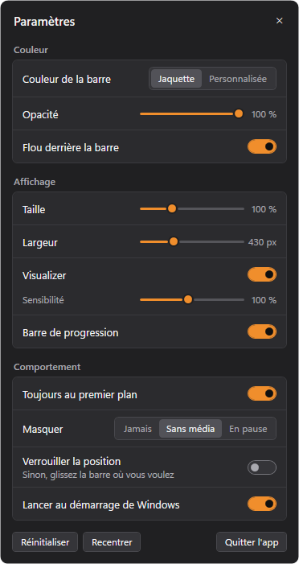

<p align="center">
  
</p>

<h1 align="center">Floating Player</h1>

<p align="center">
  Une barre flottante compacte pour Windows qui affiche ce qui joue, aux couleurs de la jaquette,<br>
  avec les contrôles de lecture et un visualizer branché sur le vrai son.
</p>

<p align="center">
  <br>
  <br>
  
</p>

<p align="center"><sub>Morceaux et jaquettes fictifs, générés par le mode démo.</sub></p>

---

## Fonctionnalités

- **Tout ce qui publie sa lecture à Windows** : YouTube dans le navigateur, Spotify, lecteurs multimédias. La barre affiche la jaquette, le titre et l'artiste.
- **Couleurs de la jaquette** : le fond et l'accent sont calculés sur la pochette, avec un fondu à chaque changement de morceau et un texte qui reste lisible. Une couleur personnalisée peut les remplacer.
- **Contrôles** : précédent, lecture/pause, suivant.
- **Timeline glissable** : glissez le bas de la barre pour vous déplacer dans le morceau, avec le timecode affiché au survol, si l'application source le permet.
- **Visualizer réel** : capture WASAPI loopback de la sortie audio et FFT, sans animation factice.
- **Discrète** : ne vole jamais le focus, n'apparaît pas dans la barre des tâches, vit dans la zone de notification.

## Réglages



La roue crantée ouvre un panneau dont les réglages s'appliquent en direct :

- couleur de la jaquette ou personnalisée ;
- opacité et flou ;
- taille et largeur ;
- visualizer et sensibilité ;
- barre de progression ;
- toujours au premier plan ;
- masquage : jamais, sans média ou en pause ;
- position libre mémorisée, verrouillable ;
- lancement au démarrage de Windows.

<br clear="right">

## Installation

Téléchargez `FloatingPlayer.msi` depuis les [releases](https://github.com/0x80070006/floating-player/releases/latest) et lancez-le. L'application démarre ensuite avec Windows, ce qui se désactive dans les réglages.

Windows 10 (1809 ou plus récent) ou Windows 11. Rien d'autre à installer, aucun accès à Internet. Le MSI n'est pas signé : Windows SmartScreen peut demander une confirmation.

## Limites

- Le visualizer écoute toute la sortie audio : un autre son de la machine le fait aussi bouger.
- Certains navigateurs retirent leur session média après une pause. La barre garde alors le morceau 15 minutes et le bouton lecture envoie la touche multimédia Lecture/Pause de Windows.
- Le bouton précédent dépend de l'application source : certaines reviennent simplement au début du morceau.
- Les coins arrondis sont réservés à Windows 11.

## Compilation

Aucun SDK requis : `build.ps1` utilise le `csc.exe` de .NET Framework, `msi.dll` et `makecab`, tous fournis avec Windows.

```bash
powershell -ExecutionPolicy Bypass -File build.ps1
```

Résultat : `dist\FloatingPlayer.exe` et `dist\FloatingPlayer.msi`.

Options utiles : `--settings` ouvre les réglages, `--demo=1` à `--demo=3` affichent un morceau fictif, `--diag` journalise l'état dans `%APPDATA%\FloatingPlayer`.

## Licence

[MIT](LICENSE)
